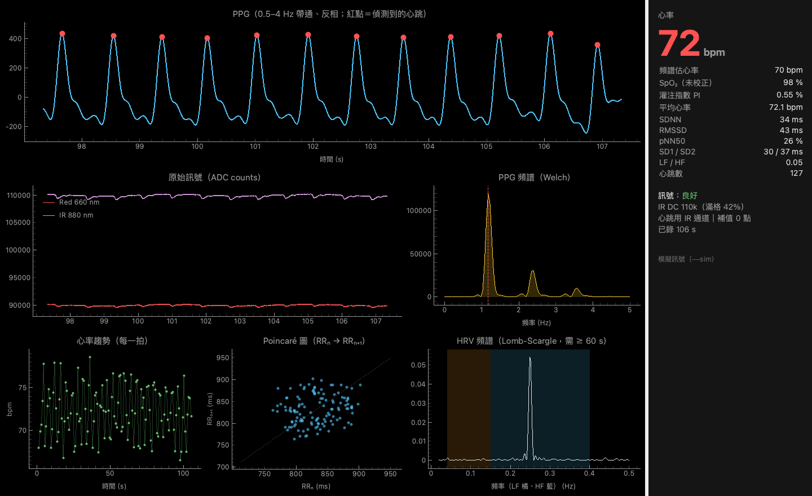
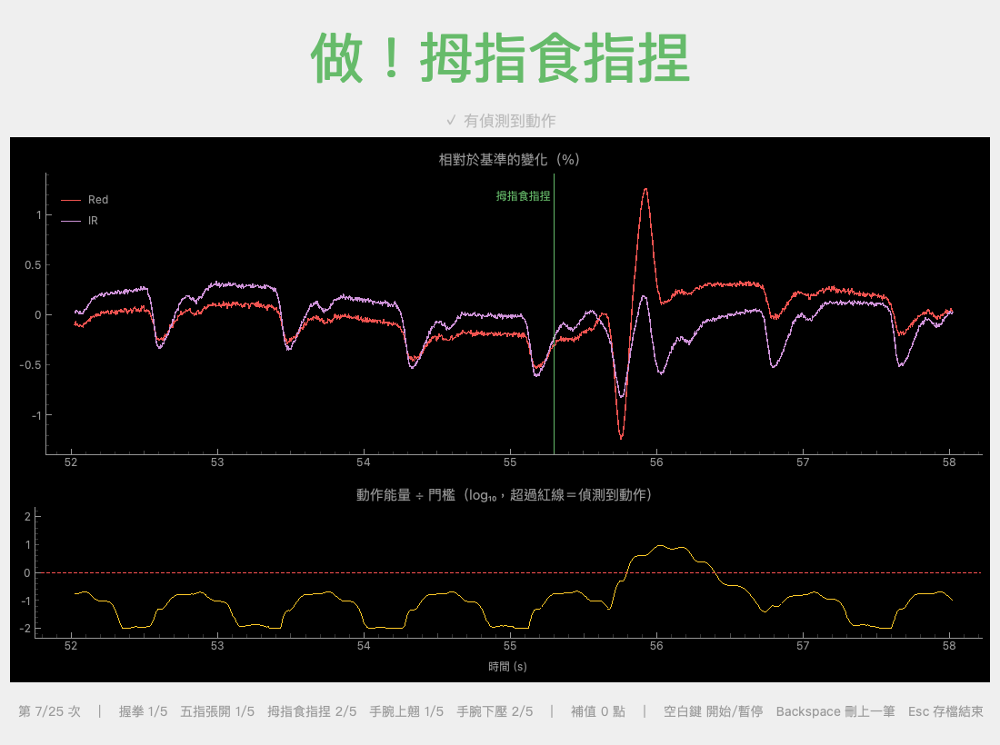
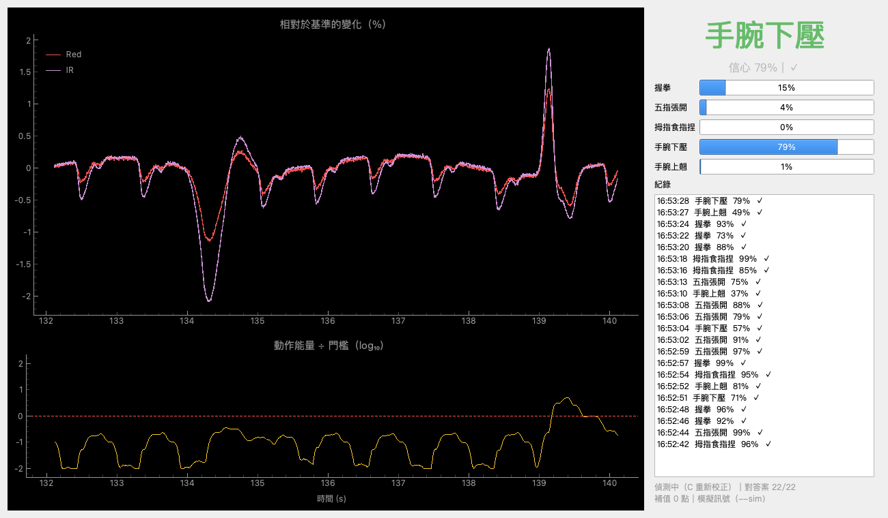
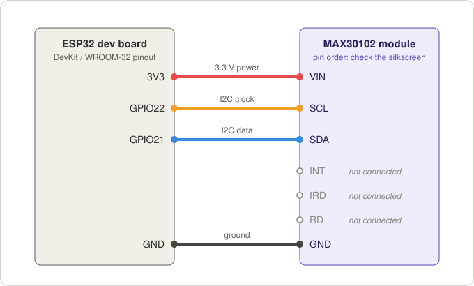

# ppg-gesture

用 **ESP32** 加上 **MAX30102** 血氧模組，量測即時心率，並用手腕上的 **PPG**（光體積變化訊號）辨識手勢。

ESP32 只負責讀感測器，把紅光、紅外光的原始資料（200 Hz）從 USB 傳到電腦。其餘全部在電腦上用 Python 執行：即時心率儀表板、錄製手勢資料、訓練模型和即時預測。



> 這份說明裡的截圖都是用內建的模擬訊號（`--sim`）截的，所以沒有硬體也能把每個工具跑一遍。程式的畫面和 `--help` 是繁體中文。English: [README.md](README.md)

## 功能

**1. 即時心率儀表板**（`host/monitor.py`）
濾波後的 PPG 波形和偵測到的心跳、紅光／紅外光原始訊號、頻譜、心率趨勢、Poincaré 圖、HRV（SDNN、RMSSD、pNN50、SD1 / SD2、LF / HF）、未校正的 SpO₂ 估計、灌注指數和訊號品質提示。

**2. 用手腕辨識手勢**（`host/collect.py` → `host/train.py` → `host/predict.py`）
手和手指的動作會擠壓手腕的動脈、牽動肌腱，讓手腕上的 PPG 感測器接收到的反射光改變。這個專案照 Zhao 等人的論文 *PPG-based Finger-level Gesture Recognition Leveraging Wearables*（IEEE INFOCOM 2018）的流程，用一顆 MAX30102 的紅光和紅外光兩個通道來實作：靜止校正、用能量偵測手勢、切段、手工設計的特徵、gradient boosting 分類器。另外附上第二篇論文的波形包絡 + SVM / 1-NN 當作對照。

| 錄製手勢 | 即時辨識 |
|---|---|
|  |  |

## 運作方式

```
MAX30102 --I2C--> ESP32（PlatformIO 韌體）--USB 序列埠，200 Hz "seq,red,ir"--> 電腦上的 Python
                                                                                |- monitor.py   心率 / HRV / SpO2
                                                                                |- collect.py   錄製有標籤的手勢
                                                                                |- train.py     切段、特徵、模型
                                                                                '- predict.py   即時辨識
```

手勢辨識的流程（`host/ppgkit/gesture.py`）：

1. **靜止校正。** 你保持不動的時候（`collect.py` 10 秒、`predict.py` 8 秒），量測高通濾波後訊號的短時能量，換算成偵測門檻。
2. **偵測。** 把訊號換成相對變化（原始值 / 直流值 − 1），做 2 Hz 高通，再算短時能量（0.25 秒視窗）跟門檻比較。能量持續超過門檻就當作手勢開始。
3. **切段。** 保留開始前 1 秒和開始後 3 秒。用能量的起訖點（有遲滯、短暫的空檔會接起來）決定手勢的視窗，再做 5 Hz 低通、降到 100 Hz。
4. **特徵**（每個通道，加上紅光與紅外光之間的）：平均、峰對峰、RMS、變異數，5 Hz 以下的 FFT 統計，Haar 小波（第 3 層），Wigner–Ville，9 個 AR 係數，紅光與紅外光的互相關，以及到每個手勢幾個代表片段的 2D-DTW 距離。
5. **分類器。** 每個手勢一個二元 gradient boosting 分類器，取分數最高的。`train.py` 也會訓練 random forest 和 SVM / 1-NN 對照組，最後存下表現最好的。

跟論文不一樣的地方：

| | Zhao 等人 | 這個專案 |
|---|---|---|
| 感測器 | 兩顆綠光 PPG 感測器，100 Hz | 一顆 MAX30102：紅光 + 紅外光兩個通道，200 Hz（特徵在 100 Hz 計算） |
| 偵測門檻 | 靜止時能量的平均 + 3σ | 預設用中位數 + 10 × MAD。校正時只要手抽動一下，σ 就會被墊高，導致大部分手勢偵測不到（`--threshold paper` 可以改回論文的算法） |
| 手勢結束點 | 用 DTW 比對使用者的脈搏樣板 | 能量突波結束的地方（`--mode energy` 改用論文固定 1.2 秒的視窗） |
| 特徵選擇 | elastic net | 沒有實作 |
| 評估方式 | 20 次 Monte-Carlo 交叉驗證，50 % 資料訓練 | 相同（預設 10 次，`--rounds 20` 就是論文的設定），另外會算跨 session 準確率 |

## 硬體

- ESP32 開發板（在 `esp32dev` 類型的 DevKit 上開發）
- **MAX30102** 模組（常見的紫色 7 pin 板子：VIN、SCL、SDA、INT、IRD、RD、GND）
- 4 條杜邦線和一條 USB 線
- 戴在手腕上用：綁帶（魔鬼氈、鬆緊帶或舊錶帶），以及擋環境光用的黑色膠帶或泡棉

### 接線



| MAX30102 | ESP32 |
|---|---|
| VIN | 3V3 |
| GND | GND |
| SDA | GPIO21 |
| SCL | GPIO22 |
| INT、IRD、RD | 不接 |

模組請接 **3V3**。不同板子的腳位順序不一樣，以絲印為準。其他 ESP32 型號會用它自己預設的 I²C 腳位；也可以在 `build_flags` 加上 `-D I2C_SDA_PIN=..` 和 `-D I2C_SCL_PIN=..` 指定。

有些便宜的 MAX30102 板子，SDA / SCL / INT 的上拉電阻接在 1.8 V 而不是 3.3 V，3.3 V 的 ESP32 可能因此讀不到感測器。如果韌體回報找不到感測器，請看[疑難排解](#疑難排解)。

## 快速開始

在 macOS 上開發和測試。程式是純 Python + pyserial + Qt，Linux 和 Windows 應該也能跑，但沒有測過。

### 1. 取得程式碼

```bash
git clone https://github.com/Timothychen00/ppg-gesture.git
cd ppg-gesture
```

### 2. 燒錄韌體

先安裝 [PlatformIO](https://platformio.org/)（VS Code 擴充套件或命令列版），然後：

```bash
cd ppg
pio run -t upload
pio device monitor
```

（PlatformIO 專案在 `ppg/` 資料夾裡；用 VS Code 的話，要開這個資料夾，不是 repo 最外層。）韌體除了 Arduino 內建的 `Wire` 之外不需要其他函式庫。Serial Monitor 的鮑率是 115200，應該會看到：

```
# MAX30102 streamer v1, columns: seq,red,ir
# i2c sda=21 scl=22
# max30102 fs=200 led_red=60 led_ir=60 range=2 ok=1
0,98213,112874
1,98220,112869
```

可以在 Serial Monitor 輸入的指令：`led <red> <ir>`（LED 電流 0–255，每格 0.2 mA）、`range <0-3>`（ADC 滿刻度 2048 / 4096 / 8192 / 16384 nA）和 `info`。

**同一個序列埠一次只能給一個程式用。** 跑 Python 工具之前要先關掉 Serial Monitor；要再上傳韌體之前，也要先關掉 Python 工具。

### 3. 安裝 Python 環境

最簡單的是 [uv](https://docs.astral.sh/uv/)。第一次執行時，它會自動安裝鎖定的套件版本（以及專案開發時用的 Python 版本）：

```bash
cd ../host
uv run monitor.py --sim      # 先不接硬體試試看
```

不用 uv 的話：

```bash
cd host
python -m venv .venv && source .venv/bin/activate
pip install -r requirements.txt
python monitor.py --sim
```

下面的指令都寫成 `uv run <程式>`；用 pip 安裝的話，換成 `python <程式>`。

### 4. 心率儀表板

```bash
uv run monitor.py                 # 自動尋找 ESP32 的序列埠
uv run monitor.py --led 90        # 訊號弱時（手腕）加大 LED 電流
uv run monitor.py --save rec.npz  # 關視窗時把原始資料存成檔案
```

| 圖 | 內容 |
|---|---|
| PPG（最上面） | 0.5–4 Hz 帶通、反相後的訊號；紅點是偵測到的心跳（峰值位置精確到取樣點以下） |
| 原始訊號 | 紅光／紅外光的 ADC 值，用來檢查有沒有飽和、貼得好不好 |
| PPG 頻譜 | Welch 頻譜，主峰頻率 × 60 就是心率 |
| 心率趨勢 | 最近 5 分鐘每一拍的瞬時心率（60 / RR） |
| Poincaré 圖 | RRₙ 對 RRₙ₊₁；SD1 是短期變異，SD2 是長期變異 |
| HRV 頻譜 | RR 序列的 Lomb-Scargle 頻譜，有 LF（0.04–0.15 Hz）和 HF（0.15–0.4 Hz）頻帶；累積 60 秒資料後才會出現 |
| 右側面板 | 心率（最近 8 拍的中位數）、頻譜估計的心率、SpO₂、灌注指數、SDNN、RMSSD、pNN50、SD1 / SD2、LF / HF、訊號品質、IR 直流值、補值的點數 |

請讓右側面板的 **IR 直流值落在滿格的 30–70 %**：太低就調大 `--led`，飽和的話就調小 `--led` 或加大 `--range`。RR 間隔在 0.33–2 秒以外，或跟附近的中位數差超過 25 % 的，會被當成雜訊排除。

### 5. 手勢辨識

先把感測器戴好（見[固定感測器](#固定感測器)），然後：

```bash
# 1) 錄製：畫面出現「做！」時做一次手勢，然後馬上放開
uv run collect.py --subject me --reps 20 --led 100

# 2) 用一份或多份錄好的資料訓練
uv run train.py data/me_*.npz

# 3) 即時辨識（一開始 8 秒要保持不動，是校正）
uv run predict.py --led 100
```

**錄製。** 一開始的 10 秒是靜止校正，請不要動。之後每一次是「準備 → 做！ → 放鬆」：手勢**做一次就馬上放開**，不要一直維持（放開的那一下會被當成第二個手勢）。畫面會立刻告訴你這次有沒有偵測到動作。按鍵：`空白鍵` 開始／暫停，`Backspace` 刪掉上一次（會排到最後重做），`Esc` 存檔並離開。每做完一次都會自動存到 `host/data/<subject>_<時間>.npz`。

手勢組合：`--preset basic`（預設：`fist` 握拳、`open` 五指張開、`pinch` 捏、`wrist_up` 手腕上翹、`wrist_down` 手腕下壓）、`--preset asl`（論文用的美國手語數字 1–9），或用 `--gestures fist,open,pinch` 自己指定。建議先錄幾個動作很大的手勢試試（例如 `--gestures fist,wrist_up,wrist_down --reps 10`，幾分鐘就錄完），再去錄大組的。

**訓練。** `train.py` 會列出每份錄音有幾次提示對應到偵測到的動作，接著是每個模型的 Monte-Carlo 交叉驗證、混淆矩陣（也會存成 PNG）、整份錄音拿來當測試集的準確率（要給不只一份錄音才會算；這是最誠實的數字，見下面），以及最重要的特徵。最好的模型會存到 `host/models/gesture_model.joblib`。

**預測。** `predict.py` 會顯示辨識出來的手勢和信心、每個手勢的機率和歷史紀錄。手勢開始後大約 3 秒才會出結果，因為要等整個動作（包含放開）結束。手臂移動過或重新戴過感測器，就按 `C` 重新校正；`--min-conf 0.6` 可以讓信心低於 60 % 的結果顯示成「？」。用 `--sim` 或 `--replay` 時，視窗還會把每個結果跟真正的手勢對答案。

### 6. 沒有硬體也能試

```bash
uv run collect.py --sim --reps 10
uv run train.py data/me_*.npz
uv run predict.py --sim
```

模擬器的手勢波形是自己設計的，只能證明整條流程可以跑通，它的準確率跟真實的手腕訊號沒有關係。

### 7. 在自己的 Python 程式裡使用模型

`predict.py` 只是在這個迴圈外面包了一層視窗：

```python
import time
import joblib
from ppgkit.gesture import LivePredictor, display_name
from ppgkit.sources import SerialSource

bundle = joblib.load("models/gesture_model.joblib")
predictor = LivePredictor(bundle)   # 前 8 秒是校正：請保持不動
src = SerialSource().start()        # 自動找 ESP32 的序列埠
try:
    while True:
        red, ir = src.read()
        for r in predictor.feed(red, ir):
            print(display_name(r["label"]), f"{r['conf']:.0%}")
        time.sleep(0.03)
finally:
    src.stop()
```

每個結果 `r` 裡還有 `r["proba"]`（順序跟 `predictor.classes` 一樣）和 `r["start"]` / `r["end"]`（手勢在資料流裡的取樣點位置）。`joblib` 檔是 Python 的 pickle：只載入自己訓練或信任的模型。

## 固定感測器

- **量心率：** 指腹的訊號最強。其他位置大致由強到弱：手指根部、耳垂（用夾子）、額頭（用頭帶）、手腕。
- **手勢：** 只能放手腕。把感測器放在**手腕內側**，離手腕橫紋大約一指寬，感測窗口貼皮膚，用綁帶固定。
- **鬆緊：** 太鬆會漏光、會滑動；太緊會把脈搏壓掉。一邊看 `monitor.py` 的灌注指數一邊調，讓它最大的鬆緊就是不錯的鬆緊。
- **環境光：** 用黑色膠帶或泡棉把感測器周圍蓋起來。不要在感測窗口上貼透明膠帶，反光會干擾訊號。
- **線材：** 用膠帶固定在前臂上，手臂動的時候才不會拉到感測器。
- **每次戴得一樣最重要。** 手勢的波形非常依賴感測器放的位置和鬆緊。把感測器固定在錶帶或護腕上（窗口周圍加一圈泡棉），在皮膚上做記號，並記住用的是綁帶的第幾個孔。

## 目前狀況與限制

這是一個實驗性的專案。

- **硬體和資料傳輸**沒問題：200 Hz 的紅光／紅外光資料從 USB 傳出來，漏掉的點會被偵測到並補值。
- **心率 / HRV** 主要是在模擬的 PPG 上開發和測試的。使用前請先用自己的參考值驗證（見下面）。**SpO₂ 沒有針對你的板子校正**，只能看趨勢。
- **手勢辨識的初步結果**（一個人、一個裝置、手腕感測器，每份錄音每個手勢 20 次）：
  - 同一次配戴內，三個動作很大的手勢（握拳、手腕上翹、手腕下壓，各 10 次）大約認對 90–95 %。
  - 五個手勢（握拳、五指張開、捏、手腕上翹、手腕下壓）大約 55–65 %。手腕下壓認得很穩（約 85–95 %）；握拳、五指張開和捏常被互相認錯。
  - **換一次配戴就無法通用。** 用一份錄音訓練的模型，去測把感測器拆下來重戴之後錄的資料，準確率接近亂猜（五個手勢只有 15–18 %）。重戴之後，同一個手勢的反應甚至可能反過來。
  - 所以目前的建議是：**在同一次配戴內錄資料、訓練、使用**；或是把感測器固定得很牢，並把多次配戴的資料一起訓練成一個模型。手勢盡量選動作差異很大的。
- 論文用的是手腕上兩顆分開的感測器。單顆 MAX30102 只在同一個位置提供兩個波長，對手指動作的資訊可能比較少。

## 怎麼知道數據準不準

- **自己數脈搏。** 記下右側面板的心跳數，用手機碼表數 60 秒脈搏（脖子或手腕），跟心跳數增加的數量比。差 0–1 下就很好。差比較多的話，看圖上有沒有波峰沒有紅點，或一個波峰有兩個紅點。
- **跟指夾式血氧機比**（夾在另一隻手指上），靜止坐著時，應該差 2–3 bpm 以內。
- **內部一致性：** 心率跟頻譜估計的心率差 3 bpm 以內、每個波峰剛好一個紅點、Poincaré 圖的點集中在對角線附近。
- **生理反應：** 站起來心率大約會上升 10–20 bpm；慢慢呼吸（吸 5 秒、吐 5 秒）時，心率趨勢會跟著起伏，HRV 頻譜在 0.1 Hz 附近會出現一個峰。
- **手勢：** 相信 `train.py` 印出的跨錄音準確率；或是重戴感測器後另外錄一份、不拿去訓練，用 `uv run predict.py --replay data/那個檔案.npz` 重播，側邊面板最下面的 `對答案 x/y`（答對 / 總數）就是真正的準確率。

## 指令說明

`monitor.py`、`collect.py`、`predict.py` 共用的參數：

| 參數 | 說明 |
|---|---|
| `--port PORT` | 序列埠（預設自動尋找，例如 `/dev/cu.usbserial-0001`、`/dev/ttyUSB0`、`COM3`） |
| `--baud N` | 鮑率，預設 115200（要跟韌體一樣） |
| `--led 0-255` | 紅光和紅外光的 LED 電流（每格 0.2 mA）。每次連線都會重送一次，因為開啟序列埠時 ESP32 會重新開機 |
| `--range 0-3` | ADC 量程：0 = 2048、1 = 4096、2 = 8192、3 = 16384 nA |
| `--swap` | 紅光和紅外光欄位對調 |
| `--sim` | 不接硬體，用內建模擬器 |
| `--replay FILE.npz` | 即時重播錄好的資料 |
| `--speed X` | `--sim` / `--replay` 的速度倍率 |

各工具自己的參數：

| 工具 | 參數 | 說明 |
|---|---|---|
| `monitor.py` | `--save FILE.npz` | 離開時存下原始資料 |
| `collect.py` | `--subject NAME` | 檔名裡用的名稱 |
| | `--preset basic\|asl`、`--gestures a,b,c` | 手勢組合 |
| | `--reps N` | 每個手勢做幾次（論文：40） |
| | `--out DIR` | 存檔資料夾（預設 `data`） |
| `train.py` | `--model auto\|gbt\|rf\|svm\|knn` | 要存哪個分類器（`auto`：交叉驗證最好的） |
| | `--compare gbt,rf,...` | 要比較哪些模型 |
| | `--rounds N`、`--train-frac F`、`--trees N` | 交叉驗證次數（10）、訓練比例（0.5）、boosting 回合數（300；論文用 2000） |
| | `--threshold robust\|paper`、`--k K` | 偵測門檻的算法和倍數。漏抓很多就調小 `--k`（例如 5），誤觸發很多就調大（例如 20） |
| | `--mode threshold\|energy`、`--hp HZ` | 切段方式、偵測用高通截止頻率（預設 2 Hz） |
| | `--out FILE` | 模型檔（預設 `models/gesture_model.joblib`） |
| `predict.py` | `--model FILE` | 要載入的模型 |
| | `--min-conf F` | 信心低於這個值就顯示「？」（預設 0.5） |

## 專案結構

```
ppg/                      PlatformIO 專案（ESP32 韌體）
  platformio.ini
  src/main.cpp            讀 MAX30102 的 FIFO，送出 "seq,red,ir" 每行一筆
host/                     Python 工具（uv 專案）
  monitor.py              心率儀表板
  collect.py              錄製手勢
  train.py                訓練與評估
  predict.py              即時手勢辨識
  ppgkit/
    sources.py            序列埠／重播來源、錄音檔讀寫
    dsp.py                濾波、心跳偵測、HRV、SpO2
    gesture.py            偵測、切段、特徵、模型
    sim.py                沒有硬體時用的模擬 PPG
  data/  models/          你的錄音和模型（第一次使用時建立，不在 git 裡）
docs/images/              這份說明用到的圖
```

### 序列埠協定與錄音格式

韌體每個取樣點送出一行 `seq,red,ir`（原始 18 bit 數值，200 Hz）。`seq` 是取樣點的計數，跳號代表有取樣點漏掉，Python 端會用內插補上。`#` 開頭的是狀態訊息。

錄音檔是 NumPy 的 `.npz`，內容有 `red`、`ir`（float32）、`fs`（Hz）、`event_index` / `event_label`（每次手勢提示的取樣點位置和名稱）、`calib`（靜止校正那段的起訖取樣點）和 `meta`（JSON 字串）。可以用 `ppgkit.sources.load_session(path)` 讀取。

## 疑難排解

| 狀況 | 處理 |
|---|---|
| `# ERROR MAX30102 not found`，而且 `# i2c scan:` 什麼都沒掃到 | 檢查接線、SDA / SCL 有沒有接反、模組有沒有接 3V3。還是不行的話，看下面的上拉電阻說明 |
| `part id 0x11` | 這塊是 MAX30100，這份韌體只支援 MAX30102 |
| 找不到序列埠 | 用 `--port` 指定（`pio device list` 可以列出所有序列埠）。CH340 或 CP210x 晶片的板子可能要先裝驅動 |
| `打不開 ...` | 別的程式佔用了序列埠：把 PlatformIO 的 Serial Monitor 關掉 |
| 上傳時 port busy | Python 工具還開著序列埠：先關掉 |
| 上傳一直卡在 `Connecting....` | 按住板子上的 BOOT 鍵，直到開始寫入才放開 |
| 波形是一條直線，或頂在最大值 | 調整 `--led` 和 `--range`，並檢查有沒有貼好、有沒有遮光 |
| 「補值」的點數一直增加 | 換一條 USB 線，或直接插在電腦上 |
| 懷疑紅光和紅外光接反 | 在 Serial Monitor 輸入 `led 60 0`（關掉紅外光），掉到接近 0 的那一欄就是紅外光。如果掉的是另一欄，就加 `--swap` |
| `train.py` 漏抓或多抓很多手勢 | 調整 `--k`（見指令說明）、校正時保持不動、把動作做大一點 |

**上拉電阻接在 1.8 V。** 有些 MAX30102 板子把 SDA / SCL / INT 的 4.7 kΩ 上拉電阻接到 1.8 V 穩壓器，而不是 3.3 V。看看背面有沒有一組 3 個焊盤的跳線（1.8 V / 3.3 V），把它焊到 3.3 V 那一側；沒有的話，就把接 1.8 V 的線路割斷，讓電阻改接到 3.3 V。只在外面另外加 3.3 V 的上拉電阻並不能解決問題。詳見[這篇說明](https://reedpaper.wordpress.com/2018/08/22/pulse-oximeter-max30100-max30102-how-to-fix-wrong-board/)（英文）。

## 參考資料

- T. Zhao, J. Liu, Y. Wang, H. Liu, Y. Chen, "PPG-based Finger-level Gesture Recognition Leveraging Wearables," *IEEE INFOCOM 2018*. https://ieeexplore.ieee.org/document/8486006
- "Principal component analysis of photoplethysmography signals for improved gesture recognition"（用 MAX30105 在手腕量 PPG；波形包絡 + SVM / 1-NN 對照組的來源）。https://pmc.ncbi.nlm.nih.gov/articles/PMC9669422/
- MAX30102 datasheet，Analog Devices / Maxim Integrated。

## 免責聲明

這是興趣／研究性質的專案，不是醫療器材。請不要用它來診斷、監測或治療任何疾病。
